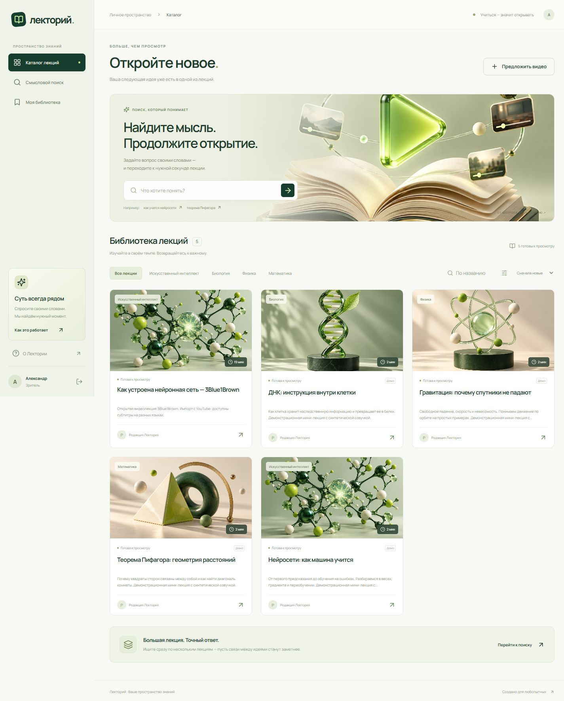

# Лекторий

Русскоязычный сервис смыслового поиска по видеолекциям. Запрос своими словами приводит к фрагменту видео с таймкодом. Рядом с плеером доступны синхронный транскрипт, конспект, оглавление, термины, ответы с источниками и личные заметки.



Светлая и тёмная темы переключаются кнопкой с луной или солнцем в верхней панели и на странице входа. Выбор сохраняется в браузере; при первом открытии используется тема системы. Цвета обеих тем заданы в `frontend/src/style.css`.

## Быстрый запуск

Нужны Python **3.12**, Node.js **22+**, примерно 2 ГБ свободного места для моделей и доступ к интернету при первом запуске. GPU и отдельная установка FFmpeg не обязательны: используется CPU, бинарный FFmpeg поставляет `imageio-ffmpeg`.

```powershell
git clone https://github.com/aerade/product2.git
cd product2
python -m venv .venv
.\.venv\Scripts\python.exe -m pip install -r requirements.lock
npm --prefix frontend ci
npm --prefix frontend run build
Copy-Item .env.example .env
.\.venv\Scripts\python.exe -m backend.cli download-models
```

Для готовой демонстрации с четырьмя озвученными мини-лекциями:

```powershell
.\.venv\Scripts\python.exe -m backend.seed
.\.venv\Scripts\python.exe scripts/serve.py
```

Откройте **http://localhost:8000**. Учётные данные трёх демо-ролей записываются только в игнорируемый файл **data/demo-access.txt**. Пароль генерируется случайно, одинаков для этих локальных демонстрационных аккаунтов. Скрипт не запускается автоматически и не меняет существующие аккаунты. Не используйте демонстрационные аккаунты в публичной установке.

В Windows для последующих запусков также доступен `powershell -ExecutionPolicy Bypass -File scripts/start.ps1`. `serve.py` запускает API и отдельный worker, Ctrl+C завершает оба процесса.

В Linux/macOS используются те же команды с `.venv/bin/python` и `cp .env.example .env`. Для воспроизведения демонстрации Windows не нужен: четыре MP4 и SRT уже входят в репозиторий. Пересоздание синтетической озвучки — отдельный Windows-скрипт `scripts/create_demo_media.ps1` с голосом Microsoft Irina Desktop.

## Чистая установка без демо

После установки зависимостей и сборки создайте первого администратора:

```powershell
.\.venv\Scripts\python.exe -m backend.cli create-admin
.\.venv\Scripts\python.exe scripts/serve.py
```

Команда интерактивно запросит email и пароль либо прочитает `ADMIN_EMAIL` / `ADMIN_PASSWORD` из окружения. Публичная регистрация всегда создаёт зрителя. Назначить преподавателя и другого администратора можно только через панель администратора. Понизить роль последнего администратора нельзя.

## Генерация ответов и конспектов

В локальном `.env` укажите OpenAI-совместимый сервер:

```dotenv
LLM_BASE_URL=https://ai.starimg.ru/v1
LLM_MODEL=claude-haiku-4-5
LLM_API_KEY=YOUR_SERVER_SIDE_KEY
```

Перезапустите API и worker после изменения `.env`. Совместимость AI STAR и `claude-haiku-4-5` проверена реальными запросами. Можно использовать другой совместимый endpoint, включая локальный сервер. Пользовательский ключ не входит в исходники, браузер или демонстрационные файлы.

С подключённым API одна задача формирует конспект, иерархию оглавления и термины. Номера фрагментов от модели проверяются сервером, таймкоды берутся из транскрипта, термины проверяются на присутствие в тексте. Ответы используют только найденный контекст и содержат ссылки на проверенные фрагменты. При недостаточной близости вопроса система отказывается отвечать. Проверка ссылок ограничивает ошибки, но не является формальным доказательством фактической точности любого ответа модели.

Без ключа приложение явно показывает **режим цитат** в вопросах и **ключевые выдержки из транскрипта** вместо генеративного конспекта. Смысловой поиск и распознавание работают локально. При сбое провайдера конспект помечается как выдержки, а вопрос показывает понятную ошибку. После подключения API можно нажать «Повторить обработку» или выполнить `python scripts/regenerate_materials.py ID_ЛЕКЦИИ`.

## Что реализовано

| Область | Возможности |
| --- | --- |
| Аккаунты | Регистрация, вход, выход, серверные HttpOnly-сессии, роли viewer/teacher/admin |
| Лекции | MP4/WebM, проверка расширения и сигнатуры, лимит размера, метаданные, курсы, редактирование и удаление |
| Импорт | YouTube/Vimeo, нормализация адресов, субтитры или распознавание аудио, внешний плеер с управлением временем |
| Обработка | FFmpeg, faster-whisper, SRT/VTT с дробными секундами, постоянная очередь SQLite, lease и восстановление после остановки |
| Поиск | Реальные многоязычные E5-эмбеддинги, ONNX на CPU, косинусная близость, одна/выбранные/все лекции |
| Просмотр | HTML5 / YouTube IFrame / Vimeo Player, подсветка транскрипта, переходы из поиска, оглавления и терминов |
| Материалы | Генеративный конспект и оглавление, ключевые термины с вхождениями, ответы с подтверждающими таймкодами |
| Личная библиотека | Закладки, создание/изменение/удаление заметок, переход в видео |
| Предложения | Ссылки от зрителей, статусы, причина отклонения, одобрение и импорт без дубликатов |
| Администрирование | Пользователи и роли, все лекции, очередь предложений, состояние обработки |

Для недоступного внешнего источника worker устанавливает `needs_transcript`, интерфейс предлагает загрузить MP4/WebM или SRT/VTT. Такие лекции не считаются готовыми и не попадают в выдачу. Активные задачи отображают этап и прогресс. Повторный запуск не создаёт вторую активную задачу.

## Роли и безопасность

Зритель смотрит готовые лекции, ищет, задаёт вопросы, сохраняет личные материалы и предлагает видео. Преподаватель дополнительно загружает, импортирует, исправляет и удаляет свои лекции. Администратор управляет всеми лекциями, предложениями и ролями.

Проверки роли и владельца выполняются на сервере при каждом запросе. Даже администратор не может прочитать или изменить чужие личные заметки через API. Пароли хешируются scrypt с отдельной солью, токены сессий хранятся в БД только как SHA-256. Изменяющие запросы проверяют Origin и служебный заголовок, вход ограничен по частоте. Сессии завершаются на сервере при выходе. Есть CSP и проверка поддерживаемых адресов до передачи в загрузчик. Файлы не раздаются как открытая статическая директория.

Для публикации за HTTPS задайте `PUBLIC_ORIGIN` реальному адресу и `COOKIE_SECURE=true`. На публичном сервере дополнительно настройте TLS reverse proxy, ограничения запросов/диска, резервное копирование `data/` и мониторинг worker. Публичное размещение в рамках этого изменения не выполнялось.

## Конфигурация

| Переменная | Значение по умолчанию / назначение |
| --- | --- |
| DATA_DIR | `./data`: SQLite, загруженные файлы, модели |
| HOST / PORT | `127.0.0.1` / `8000` |
| PUBLIC_ORIGIN | `http://localhost:8000`, защита изменяющих запросов |
| COOKIE_SECURE | `false` локально, `true` при HTTPS |
| MAX_UPLOAD_MB | `500`, максимальный размер MP4/WebM; SRT/VTT ограничены 10 МБ |
| SESSION_DAYS | `7` |
| EMBEDDING_REPO / EMBEDDING_FILE | `Xenova/multilingual-e5-small` / `onnx/model_quantized.onnx` |
| SEARCH_MIN_SCORE | `0.79`, фильтр близости в выдаче, требует настройки на ваших данных |
| WHISPER_MODEL | `base`, многоязычное распознавание |
| WHISPER_DEVICE / WHISPER_COMPUTE_TYPE | `cpu` / `int8` |
| FFMPEG_PATH | Необязательно, собственный бинарный FFmpeg |
| LLM_BASE_URL / LLM_API_KEY / LLM_MODEL | Серверный адаптер генерации |
| ADMIN_EMAIL / ADMIN_PASSWORD | Только команда начального создания администратора |
| DEMO_PASSWORD | Необязательный пароль для явного запуска demo seed, минимум 10 символов |

Смена embedding-модели требует повторной обработки лекций. Векторы помечены идентификатором модели, несовместимые индексы не смешиваются. Поиск использует точный перебор нормализованных векторов в NumPy; для большого каталога следует перейти на pgvector/Qdrant. SQLite с внешними ключами и связями подходит для прототипа; для PostgreSQL потребуется миграция SQL и обработчика очереди.

## Docker

```sh
cp .env.example .env
# Заполните локальные параметры и ключ при необходимости
docker compose up --build -d
docker compose exec lectory python -m backend.cli download-models
docker compose exec lectory python -m backend.seed
```

Порт привязан к localhost, данные сохраняются в именованном томе. Docker-конфигурация подготовлена, но в этой среде Docker-запуск не проверялся. При установке без демо вместо seed выполните `docker compose exec lectory python -m backend.cli create-admin`.

## Разработка и проверки

```sh
python -m pytest -q
npm --prefix frontend run build
```

Проверки не скачивают модели и используют временную БД. 34 теста проверяют права, приватность, CSRF, файлы, атомарную замену индекса, очередь, восстановление задач, импорт и ответы. Для тестов бизнес-логики внешние модели подменяются фикстурами. Реальные модели и публичный источник отдельно проверены интеграционно: результаты в [docs/verification.md](docs/verification.md).

Для Vite development server (`npm --prefix frontend run dev`) укажите `PUBLIC_ORIGIN=http://localhost:5173` и откройте `localhost:5173`. Запустите API и worker отдельно:

```sh
python -m uvicorn backend.app:app --host 127.0.0.1 --port 8000
python -m backend.worker
```

API-документация: `/docs`. Команда `python scripts/integration_check.py` требует локальной демо-установки, запущенных API/worker и `work/asr-test.mp4`. Она создаёт тестовую лекцию, проверяет реальное распознавание и импорт YouTube. Это дополнительная проверка с сетевыми запросами, не часть изолированного pytest.

## Материалы защиты

- [Сценарий демонстрации](docs/demo-script.md)
- [Презентация](docs/lectory-presentation.pptx)
- [Скриншоты](docs/screenshots)
- [Архитектура и ограничения](docs/architecture.md)
- [Сгенерированные изображения и промпты](docs/design-assets.md)

Четыре демонстрационные мини-лекции созданы для этого прототипа и помечены как демо. Озвучка синтетическая. Чужие видео не включены в репозиторий: импортированная лекция 3Blue1Brown остаётся на YouTube. Сгенерированные иллюстрации — визуальные метафоры, а не научные схемы.

Шрифт Manrope распространяется по SIL Open Font License, файл лицензии находится рядом со шрифтом. Официальные источники зависимостей: [E5 ONNX](https://huggingface.co/Xenova/multilingual-e5-small), [faster-whisper](https://github.com/SYSTRAN/faster-whisper), [yt-dlp](https://github.com/yt-dlp/yt-dlp), [YouTube IFrame API](https://developers.google.com/youtube/iframe_api_reference), [Vimeo Player](https://github.com/vimeo/player.js).
