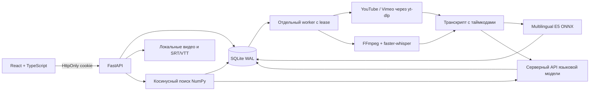

# Архитектура Лектория

`scripts/serve.py` управляет API и дочерним worker. Можно запускать worker отдельно. SQLite хранит задачи до обработки, lease продлевается heartbeat каждые 30 секунд. После истечения lease незавершённую задачу может подхватить перезапущенный worker. Производные данные заменяются в одной транзакции. Пока индекс обновляется, лекция исключается из выдачи.

Модель поиска работает локально на CPU. Тексты имеют E5-префиксы `query:` и `passage:`, mean pooling учитывает attention mask, векторы нормализованы. Индекс хранит float32 в BLOB и идентификатор модели. Смысловые блоки ограничены примерно 300 символами / 35 секундами без обрезки таймкодов исходных сегментов. Длинный единичный сегмент распознавания остаётся одним блоком; модель ограничивает его 512 токенами. Для нестандартных субтитров с очень длинными одиночными репликами стоит предварительно разделить реплики.

Внешний плеер YouTube использует официальный IFrame API, Vimeo — Player SDK. Переход из результата задаёт стартовую секунду, клики по транскрипту вызывают seek, события/опрос времени обновляют текущую строку. Локальное видео раздаётся FileResponse с авторизацией и Range-запросами.

В БД отдельные сущности users, sessions, courses, lectures, processing_jobs, transcript_segments, search_chunks, outline_sections, key_terms, bookmarks, notes, video_suggestions. Личные данные связываются с владельцем. Удаление лекции каскадно удаляет её индекс, транскрипт и личные материалы, отвязывает рассмотренное предложение и удаляет принадлежащую лекции медиапапку.

## Границы прототипа

- Блокировки конкретного YouTube/Vimeo, региона или IP могут мешать импорту и воспроизведению. Успешный импорт публичной YouTube-лекции проверен, Vimeo вернул 403 в текущей сети.
- Конспект, оглавление и термины создаются после транскрипции. Для очень длинного текста адаптер выбирает фрагменты по всей лекции, чтобы уложиться в контекст 55 тысяч символов; полнота конспекта снижается.
- Порог E5 для отказа в ответе и фильтра выдачи эвристический. Качество на предметной коллекции следует отдельно измерить и откалибровать. Проверенные ссылки на контекст не гарантируют отсутствие всех ошибок генерации.
- Реализована одна общая библиотека готовых лекций. Раздельные закрытые группы и платные курсы в этот объём не входят.
- Нет сброса пароля по почте, хранения истории вопросов, антивирусного сканирования, S3, HA-очереди и нагрузочного теста большой коллекции.
- Docker и Linux CI подготовлены. Локальные проверки выполнены на Windows, контейнерная сборка требует отдельного прогона.
